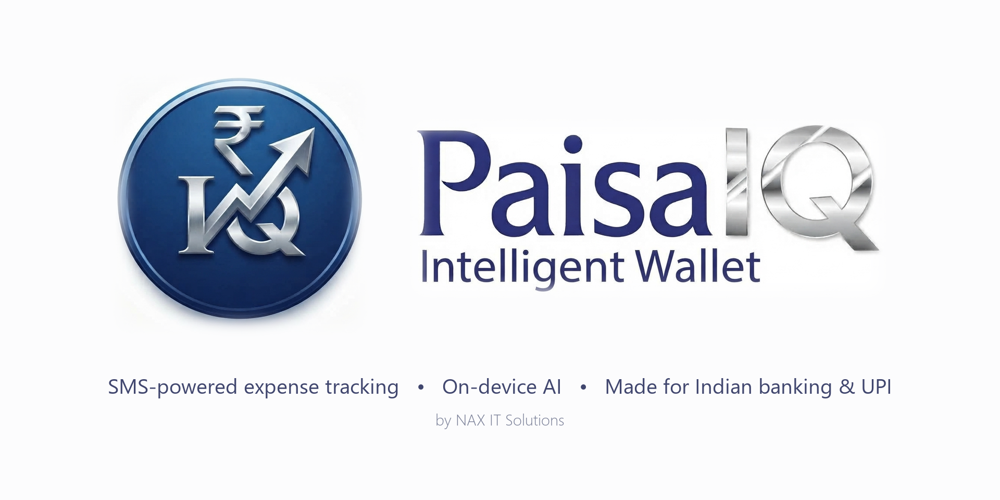

<a name="top"></a>

[](https://github.com/ravisharma117/PaisaTracker)

[](LICENSE)
[](https://developer.android.com/about/versions/oreo)
[](https://kotlinlang.org/)
[](app/build.gradle.kts)
[](PRIVACY.md)

# Paisa IQ — Intelligent Wallet

Paisa IQ turns your bank SMS, bank-app notifications and UPI statements into one clean, searchable money timeline. It adds budgets, bills, recurring entries, lending, net worth and an on-device AI assistant. Your financial data is processed on your phone, not on a server.

> **Paisa IQ** is a fork of [Cashiro](https://github.com/ritesh-kanwar/Cashiro) by its original authors, maintained by [NAX IT Solutions](https://naxits.com/paisaiq) and focused on Indian banking and UPI. Application ID: `com.naxits.paisatracker`. It is licensed under AGPL-3.0, like the original.
>
> **References** — projects that shape how Paisa IQ is built:
> - [Cashiro](https://github.com/ritesh-kanwar/Cashiro), the upstream app this fork is based on
> - [Expensify App](https://github.com/Expensify/App/tree/main), for product and UX direction

## How it works

1. Grant read-only SMS permission. Paisa IQ never changes your inbox or sends messages. You can also import GPay and PhonePe PDF statements, or allow notification access to read bank-app alerts.
2. Paisa IQ parses each message on your phone and pulls out the amount, merchant, account, category and date.
3. Use Home, Analysis and Transactions to see where your money goes, and ask the on-device AI assistant questions such as "What did I spend on food last month?"

## Features

### New in Paisa IQ

- **🔒 App PIN lock** — 4-digit PIN with optional recovery by email, plus a setting that hides headline totals on screen
- **💵 Cash account and account kinds** — a built-in Cash account; bank, card and wallet accounts are told apart in one place
- **↕️ Account order** — arrange accounts once and that order is used everywhere
- **📂 Category analysis** — spending per category by month, with a detail view per category
- **🏠 Customisable Home** — Monthly Summary and Recurring cards; every Home card can be moved or hidden
- **🔁 Recurring transactions** — entries that create themselves on schedule, with reminders
- **🧾 Bills and subscriptions** — tracked per billing cycle, with an upcoming-payments view
- **🤝 Lending and borrowing** — due-date reminders and repayment suggestions when a matching payment arrives
- **📊 Net worth** — holdings and loans with a monthly trend
- **📅 Month and Year trackers** — on the Analysis tab
- **🏷️ Entry options** — mark an entry as "not income" or as an account-to-account transfer so totals stay accurate
- **🎨 New brand** — Paisa IQ icon, splash screen and in-app logo

### From Cashiro

- **🤖 SMS parsing** — 130+ bank, card and wallet parsers across 14 countries
- **🔔 Bank-app notifications** — reads transaction alerts from supported bank apps
- **🗂️ PDF statements** — imports GPay and PhonePe UPI statements
- **💰 Budgets** — monthly budgets with progress and history
- **📂 Categories** — custom categories and subcategories
- **📈 Charts** — animated line, bar and heatmap charts
- **🌍 Multi-currency** — per-account currencies with conversion
- **🔄 Subscription detection** — finds recurring payments in your SMS
- **💬 On-device AI assistant** — Qwen 2.5 running locally through MediaPipe
- **📤 Export and backup** — CSV export, Cashew import, and optional backup to your own Google Drive or WebDAV server
- **👤 Profiles, widgets and shortcuts** — user profiles, Quick Settings tiles and app shortcuts for adding entries

## Supported Banks & Countries

Paisa IQ ships **130+ parsers** for banks, cards and wallets across **14 countries**. Each parser lives in [`parser-core`](parser-core/src/main/kotlin/com/ritesh/parser/core/bank/); see [docs/BANK_SUPPORT.md](docs/BANK_SUPPORT.md) for details.

### 🇮🇳 India (40+ banks) - INR ₹
- **HDFC Bank**, **State Bank of India (SBI)**, **ICICI Bank**
- **Axis Bank**, **Punjab National Bank (PNB)**, **IDBI Bank**
- **Indian Bank**, **Federal Bank**, **Karnataka Bank**, **Kerala Gramin Bank**
- **Canara Bank**, **Bank of Baroda**, **Bank of India**, **Union Bank**
- **Jupiter (CSB Bank)**, **Amazon Pay (Juspay)**, **Kotak Bank**
- **IDFC First Bank**, **HSBC Bank**, **Central Bank of India**
- **South Indian Bank**, **JK Bank**, **Indian Overseas Bank**
- **Airtel Payments Bank**, **AMEX**, **IPPB**, **DOP (Post Office)**
- **OneCard**, **UCO Bank**, **AU Bank**, **Yes Bank**, **Bandhan Bank**
- **IndusInd Bank**, **City Union Bank**, **Dhanlaxmi Bank**, **Standard Chartered**
- **Equitas Small Finance Bank**, **Saraswat Bank**, **DBS Bank**, **Utkarsh Bank**
- *Services*: **Slice**, **LazyPay**, **Jio Pay**, **Juspay**

### 🇺🇸 USA (7 banks) - USD $
- **Citi Bank**, **Discover Card**, **Old Hickory Credit Union**, **Charles Schwab**
- **Navy Federal Credit Union**, **AdelFi Credit Union**, **Huntington Bank**

### 🇦🇪 UAE (5 banks) - AED د.إ
- **First Abu Dhabi Bank (FAB)**, **Abu Dhabi Commercial Bank (ADCB)**
- **Emirates NBD**, **Liv Bank**, **Mashreq Bank**

### 🇳🇵 Nepal (7 banks) - NPR ₨
- **Laxmi Sunrise Bank**, **Everest Bank**, **NMB Bank**, **Nabil Bank**
- **Manjushree Finance**, **Siddhartha Bank**, **Prime Commercial Bank**

### 🇹🇭 Thailand (11 banks/cards) - THB ฿
- **Bangkok Bank**, **Kasikorn Bank**, **Siam Commercial Bank**, **Krungthai Bank**
- **Krungsri (Bank of Ayudhya)**, **TMBThanachart (TTB)**, **Government Savings Bank (GSB)**
- **BAAC**, **UOB Thailand**, **CIMB Thai**, **KTC Credit Card**

### 🇪🇹 Ethiopia (4 banks/services) - ETB ብር
- **Commercial Bank of Ethiopia (CBE)**, **Telebirr**, **Zemen Bank**, **Dashen Bank**

### 🇹🇿 Tanzania (3 services) - TZS TSh
- **M-Pesa Tanzania**, **Selcom Pesa**, **Tigo Pesa (Mixx by Yas)**

### 🇵🇰 Pakistan (2 banks) - PKR ₨
- **Faysal Bank**, **Standard Chartered Bank**

### 🇮🇷 Iran (2 banks) - IRR ﷼
- **Melli Bank**, **Parsian Bank**

### 🇸🇦 Saudi Arabia (1 bank) - SAR ﷼
- **Alinma Bank (بنك الإنماء)** - Arabic SMS support

### 🇪🇬 Egypt (1 bank) - EGP E£
- **CIB (Commercial International Bank)**

### 🇰🇪 Kenya (1 service) - KES Ksh
- **M-PESA** - Mobile money service

### 🇨🇴 Colombia (1 bank) - COP $
- **Bancolombia**

### 🇧🇾 Belarus (1 bank) - BYN Br
- **Priorbank** - Russian/Belarusian SMS support

Missing your bank? [Request it →](https://github.com/ravisharma117/PaisaTracker/issues/new/choose)

## Privacy First

Parsing, categorisation and the AI assistant run on your phone. There are no analytics, ads or trackers. The app goes online only for:

- **The AI model** — a one-time download of the Qwen 2.5 model
- **Exchange rates** — for converting between currencies
- **Features you switch on yourself** — backup to your own Google Drive or WebDAV server, webhooks to a URL you configure, and the PIN recovery email

See [PRIVACY.md](PRIVACY.md) for the full policy.

## Screenshots

> These screenshots are from upstream Cashiro and will be replaced with Paisa IQ screens.

<table>
<tr>
<td></td>
<td></td>
<td></td>
<td></td>
</tr>
<tr>
<td align="center">Home</td>
<td align="center">Analytics</td>
<td align="center">AI Chat</td>
<td align="center">Settings</td>
</tr>
<tr>
<td></td>
<td></td>
<td></td>
<td></td>
</tr>
<tr>
<td align="center">Subscriptions</td>
<td align="center">Transactions</td>
<td align="center">Account Details</td>
<td align="center">Categories</td>
</tr>
<tr>
<td></td>
<td></td>
<td></td>
<td></td>
</tr>
<tr>
<td align="center">Budgets</td>
<td align="center">Budget Details</td>
<td align="center">Budget History</td>
<td align="center">Profile</td>
</tr>
</table>

## Getting Started

There is no published release yet, so build from source.

```bash
# Clone the repository
git clone https://github.com/ravisharma117/PaisaTracker.git
cd PaisaTracker

# Build debug APKs for both flavors
./gradlew :app:assembleStandardDebug :app:assembleFdroidDebug

# Or build and install straight onto a connected device
./gradlew :app:installStandardDebug
```

### Build flavors

| Flavor | Use | Differences |
| --- | --- | --- |
| `standard` | Play Store builds | Adds Google Play in-app updates and in-app review; per-ABI APK splits |
| `fdroid` | F-Droid and other stores | No Google libraries; one universal APK |

### Requirements

- Android 8.0+ (API 26) on the device; the app targets API 36
- A recent Android Studio, or JDK 17+ for Gradle (the code compiles to Java 11)

### Notification access shows "Restricted settings"

On Android 13+, an APK installed by tapping the file (from a file manager, browser or chat app) cannot get notification access at first. Installs through `adb`, Android Studio or the Play Store are not affected. To allow it on a sideloaded install:

1. Tap the greyed-out notification access toggle once, so Android shows its "Restricted settings" dialog.
2. Open **Settings → Apps → Paisa IQ**, tap **⋮** and choose **Allow restricted settings**.
3. Return to Paisa IQ and turn on notification access.

The app's notification access dialog shows the same steps and a button to open App info.

## Tech Stack

<p align="center">
  <br>
  
</p>

**Architecture**: MVVM + Clean Architecture • Jetpack Compose • Material 3 • Room • Coroutines and StateFlow • Hilt • WorkManager • MediaPipe LLM (Qwen 2.5)

## Project Structure

Two Gradle modules:

- **`app`** — the Android app
- **`parser-core`** — the bank SMS parsers, as plain Kotlin with no Android dependencies

The app is split into data, domain and presentation layers:

```
com.naxits.paisatracker
├── core                # Constants and precompiled patterns
├── data                # Room database, repositories, backup, cloud sync, preferences, security
├── domain              # Use cases and domain models
├── presentation        # Jetpack Compose UI
│   ├── ui              # Screens (features/), shared components, theme, icons
│   └── navigation      # Navigation graph and destinations
├── di                  # Hilt modules
├── receiver            # SMS, bank-app notification listener, boot, alarm and update receivers
├── service             # Quick Settings tiles
├── worker              # WorkManager jobs (SMS scan, notification retry, webhook sync)
├── initializer         # WorkManager start-up
└── utils               # Helpers and extensions
```

### Documentation

| Document | What it covers |
| --- | --- |
| [docs/architecture.md](docs/architecture.md) | Layers, patterns and responsibilities |
| [docs/design.md](docs/design.md) | Material 3 theming, colours, typography and components |
| [docs/state-management.md](docs/state-management.md) | StateFlow and unidirectional data flow |
| [docs/database-migrations.md](docs/database-migrations.md) | Writing and registering Room migrations |
| [docs/CONTRIBUTING_BANK_PARSERS.md](docs/CONTRIBUTING_BANK_PARSERS.md) | Adding a new bank parser |
| [docs/parser-test-standards.md](docs/parser-test-standards.md) | How parser tests are written |
| [docs/RELEASE.md](docs/RELEASE.md) | Release process |

## Roadmap

The first roadmap for Paisa IQ is complete: rebrand, Cash account, account order, PIN lock and privacy mode, category analysis, Home cards, recurring transactions, bills, lending reminders, net worth and the Month and Year trackers. The next plan will be added here when it starts.

## Contributing

See [CONTRIBUTING.md](CONTRIBUTING.md) for guidelines, and read the [Code of Conduct](CODE_OF_CONDUCT.md) before taking part. Work happens on `feature/<name>` branches off `develop`.

```bash
./gradlew test                              # All unit tests
./gradlew :app:testStandardDebugUnitTest    # App unit tests only
./gradlew lint                              # Lint
```

## Community & Support

- **Bugs and feature requests** — [open an issue](https://github.com/ravisharma117/PaisaTracker/issues/new/choose)
- **Website** — [naxits.com/paisaiq](https://naxits.com/paisaiq)

## Security

See the [Security Policy](SECURITY.md) for how to report vulnerabilities.

## Acknowledgements

- **[Cashiro](https://github.com/ritesh-kanwar/Cashiro)** — the upstream app Paisa IQ is forked from
- **[PennyWise AI](https://github.com/sarim2000/pennywiseai-tracker)** — the base and inspiration for Cashiro
- **[Microsoft Fluent Emojis](https://github.com/microsoft/fluentui-emoji)** — category icons
- **[Haze](https://chrisbanes.github.io/haze/latest/)** — blur effects
- **[Compose Charts](https://github.com/ehsannarmani/ComposeCharts)** — animated charts and graphs
- **[Reorderable](https://github.com/Calvin-LL/Reorderable)** — drag-to-reorder lists
- **[Peeps Ui8](https://peeps.ui8.net/)** — built-in user avatars
- **[Iconax](https://iconsax.io/)** — icons
- **[Google AI Studio](https://aistudio.google.com/prompts/new_chat?model=gemini-3.1-flash-lite-image)** (Gemini 3.1 Flash Lite Image) — AI agent that created the Paisa IQ app icon and logo; the launcher icon, splash and cover image are derived from them

## License

GNU Affero General Public License v3.0 — see [LICENSE](LICENSE). Paisa IQ keeps the license of the upstream Cashiro project.

---

<p align="center">
<a href="https://github.com/ravisharma117/PaisaTracker">Source</a> •
<a href="https://github.com/ravisharma117/PaisaTracker/issues/new/choose">Report Bug</a> •
<a href="https://github.com/ravisharma117/PaisaTracker/issues/new/choose">Request Feature</a> •
<a href="https://naxits.com/paisaiq">Website</a>
</p>
